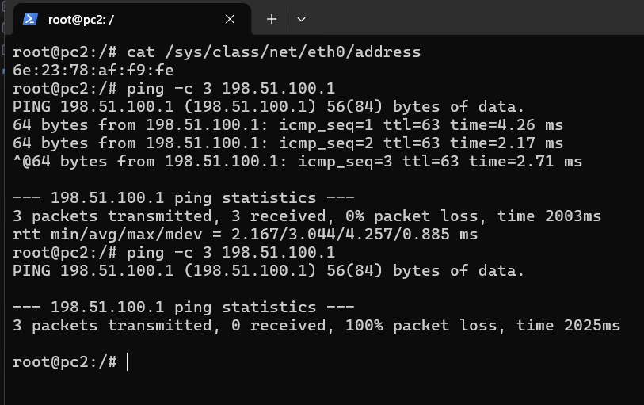
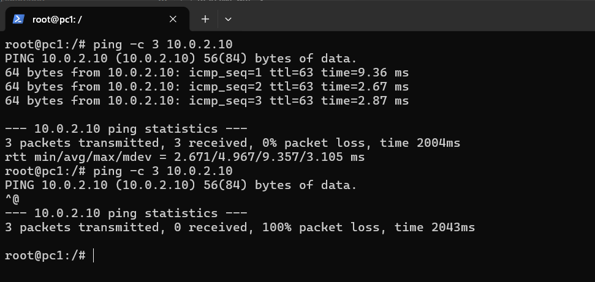
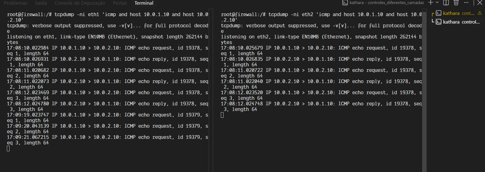
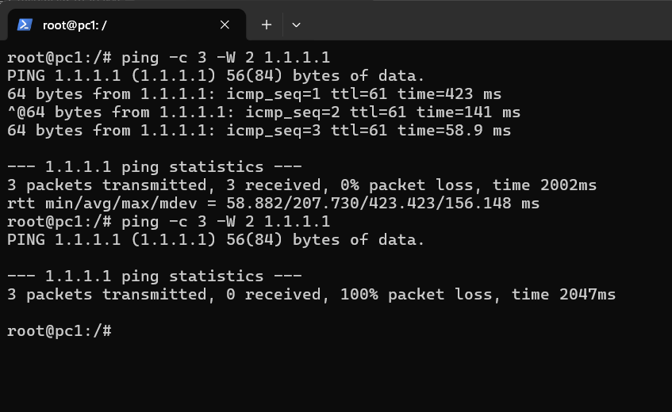
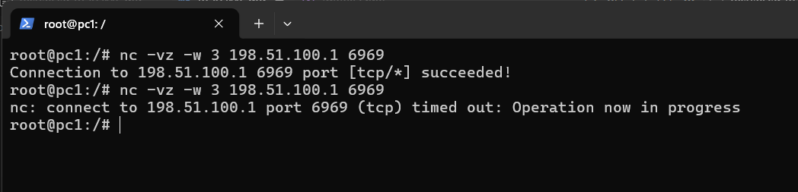

# Laboratorio de seguranca de perimetro — Kathara

Este repositorio contem uma topologia Kathara com LAN, DMZ, rede de gerenciamento, firewall e roteador de borda. Os testes abaixo permitem observar controles em L2, L3 e L4 e discutir suas limitacoes. A descricao detalhada da arquitetura e das regras ativas esta em [topologia-e-politicas.md](topologia-e-politicas.md).

> **Estado inicial importante:** `firewall.startup` aplica politicas `DROP` a `INPUT`, `OUTPUT` e `FORWARD`; permite conexoes encaminhadas ja estabelecidas e permite LAN → WAN de forma ampla. As regras L2 por MAC, L3 por IP e L4 por portas deste README sao comandos de demonstracao: nao estao no arquivo de inicializacao e, portanto, nao persistem depois de reiniciar o laboratorio. Para aplicar a politica em toda inicializacao, transfira as regras escolhidas para `firewall.startup`, antes das permissoes mais amplas correspondentes.

## Topologia e enderecamento

| No | Rede / interface | Endereco |
|---|---|---|
| `pc1` | LAN / `eth0` | `10.0.1.10/24` |
| `pc2` | LAN / `eth0` | `10.0.1.11/24` |
| `firewall` | WAN / `eth0` | `198.51.100.2/30` |
| `firewall` | LAN / `eth1` | `10.0.1.1/24` |
| `firewall` | DMZ / `eth2` | `10.0.2.1/24` |
| `firewall` | Gerenciamento / `eth3` | `10.0.3.1/24` |
| `roteador_borda` | WAN / `eth0` | `198.51.100.1/30` |
| `web` | DMZ / `eth0` | `10.0.2.10/24` |
| `dns` | DMZ / `eth0` | `10.0.2.11/24` |
| `adm` | Gerenciamento / `eth0` | `10.0.3.10/24` |

O firewall encaminha trafego entre as redes. Em `firewall.startup`, `eth0` e WAN, `eth1` e LAN, `eth2` e DMZ, e `eth3` e gerenciamento.

## Como iniciar

Entre na pasta que contem o `lab.conf` do laboratorio e execute o comando a partir dela:

```bash
cd controles_diferentes_camadas
kathara lstart
```

O `lab.conf` nao esta na raiz do repositorio; executar `kathara lstart` na raiz nao inicia esta topologia.

Abra terminais para os nos usados nos testes:

```bash
kathara connect pc1
kathara connect pc2
kathara connect firewall
kathara connect roteador_borda
```

Os comandos `iptables` devem ser executados como root no no `firewall`. Os testes de cliente devem ser feitos no no indicado, normalmente `pc1` ou `pc2`.

## Politica de seguranca implementada

As regras existentes usam uma abordagem de lista de permissao para trafego encaminhado, com uma excecao ampla de saida da LAN:

| Origem | Destino | Comunicacao permitida pela configuracao inicial |
|---|---|---|
| LAN (`eth1`) | WAN (`eth0`) | Trafego encaminhado em geral; o bloqueio para `1.1.1.1` e demonstrado no experimento L3 e nao esta ativo inicialmente |
| LAN | DMZ (`eth2`) | ICMP; HTTP/HTTPS para `10.0.2.10`; DNS UDP/TCP para `10.0.2.11` |
| WAN (`eth0`) | DMZ | ICMP; HTTP/HTTPS para `10.0.2.10`; DNS UDP/TCP para `10.0.2.11` |
| Qualquer rede encaminhada | Conexoes existentes | Respostas `ESTABLISHED,RELATED` |
| Outras origens/destinos encaminhados | — | Bloqueados pela politica `FORWARD DROP`, salvo regras anteriores |
| Trafego destinado ao firewall / originado pelo firewall | — | Bloqueado pelas politicas `INPUT DROP` e `OUTPUT DROP`, salvo regras que venham a ser adicionadas |

A permissao LAN → WAN generica significa que, no estado inicial, ainda nao existe bloqueio efetivo de portas BitTorrent nem do destino `1.1.1.1`. Os bloqueios dos experimentos L2, L3 e L4 sao inseridos manualmente e nao persistem ao reiniciar o laboratorio.

## Experimentos e evidencias

Para cada experimento, registre a saida obtida no proprio laboratorio. Nao interprete falha de DNS, indisponibilidade de um servidor externo ou ausencia de rota como evidencia de bloqueio por firewall. A evidencia deve correlacionar o teste do cliente com os contadores da regra no firewall.

### L2 — filtro por endereco MAC na entrada da LAN

Este teste bloqueia o trafego encaminhado de `pc2` com base no endereco MAC de origem. Ele demonstra filtragem por atributo L2 no firewall roteado; **nao** transforma o firewall em um switch de filtragem. `pc1` e `pc2` estao na mesma LAN e podem comunicar-se diretamente em L2, sem atravessar o firewall.

**Investigacao — o MAC acompanha o pacote pela Internet?** Nao. O endereco MAC pertence ao cabecalho Ethernet do enlace local e e substituido a cada salto roteado. O firewall consegue verificar o MAC original de `pc2` quando recebe o quadro pela interface ligada a LAN (`eth1`), antes de encaminha-lo. Na interface WAN, o quadro de saida usa os enderecos MAC do enlace WAN; o MAC de `pc2` nao e preservado ate a Internet. A regra so identifica esse MAC no trecho local em que ele chega ao firewall.

1. No `pc2`, obtenha o MAC:

   ```bash
   cat /sys/class/net/eth0/address
   ```

2. **Antes da regra**, no `pc2`, tente pingar o roteador de borda. No firewall, anote os contadores antes do teste:

   ```bash
   # pc2
   ping -c 3 198.51.100.1

   # firewall
   iptables -vnL FORWARD --line-numbers
   ```

   Se o ping nao funcionar antes da regra, esse destino nao serve como evidencia para este experimento; verifique conectividade e rotas primeiro.

3. **Regra implementada**, no firewall, substituindo `<MAC_DE_PC2>` pelo valor coletado:

   ```bash
   iptables -I FORWARD 1 -i eth1 -s 10.0.1.11 \
     -m mac --mac-source <MAC_DE_PC2> -j DROP
   ```

4. **Depois da regra**, repita o ping no `pc2` e consulte os contadores no firewall. O comportamento esperado e o ping deixar de passar e o contador da regra `DROP` aumentar. Como controle, repita o ping de `pc1`: esta regra nao deve bloquear `pc1`. A regra descarta, na cadeia `FORWARD`, todo protocolo que atravesse o firewall com esse MAC de origem; ela nao bloqueia comunicacoes locais entre `pc1` e `pc2` na mesma LAN.

**Evidencia a guardar:** saida do ping antes e depois, MAC usado e contador da regra antes/depois.



### L3-A — bloqueio de ICMP entre LAN e DMZ

Este experimento bloqueia os pedidos ICMP iniciados por `pc1` (`10.0.1.10`) para o servidor Web na DMZ (`10.0.2.10`). O `firewall` encaminha esse trafego da LAN (`eth1`) para a DMZ (`eth2`).

1. **Antes da regra**, inicie uma captura em cada interface do firewall, em terminais separados:

   ```bash
   # firewall, terminal 1: pacote entrando pela LAN
   tcpdump -ni eth1 'icmp and host 10.0.1.10 and host 10.0.2.10'

   # firewall, terminal 2: pacote encaminhado para a DMZ
   tcpdump -ni eth2 'icmp and host 10.0.1.10 and host 10.0.2.10'
   ```

   Com as capturas ativas, execute no `pc1`:

   ```bash
   ping -c 3 10.0.2.10
   ```

   O ping deve responder; as capturas devem mostrar os pedidos ICMP chegando por `eth1` e sendo encaminhados por `eth2`. Pare as capturas com `Ctrl+C` e anote os resultados.

2. **Regra implementada**, no firewall, para descartar os pedidos ICMP de `pc1` para o servidor Web:

   ```bash
   iptables -I FORWARD 1 -i eth1 -o eth2 -s 10.0.1.10 \
     -d 10.0.2.10 -p icmp -j DROP
   ```

3. **Depois da regra**, reinicie as duas capturas e repita no `pc1`:

   ```bash
   ping -c 3 10.0.2.10
   ```

   O ping deve falhar. O `tcpdump` em `eth1` ainda deve observar os pedidos chegando ao firewall, mas a captura em `eth2` nao deve observar esses pedidos sendo encaminhados para a DMZ. Confirme tambem que o contador da regra aumenta:

   ```bash
   iptables -vnL FORWARD --line-numbers
   ```

Esta regra demonstra o bloqueio no sentido LAN → DMZ para esse par de enderecos; nao bloqueia automaticamente ICMP entre quaisquer outras redes ou hosts. Como e inserida manualmente, ela deixa de existir ao reiniciar o laboratorio, a menos que seja adicionada ao `firewall.startup`.

**Evidencia a guardar:** ping e capturas `tcpdump` antes/depois, junto com o contador da regra `DROP`.




### L3-B — bloqueio por endereco IP de destino

Este experimento demonstra o bloqueio por endereco IP de destino: todo o trafego encaminhado de `pc1` (`10.0.1.10`) para `1.1.1.1` sera descartado, independentemente da porta ou do protocolo de transporte. Como `1.1.1.1` e externo ao laboratorio, valide que ele esta alcancavel antes de aplicar a regra; uma falha anterior pode indicar indisponibilidade ou falta de acesso a Internet, nao filtragem.

1. **Antes da regra**, no `pc1`, confirme que o destino responde e, no firewall, registre as regras e contadores atuais:

   ```bash
   # pc1
   ping -c 3 -W 2 1.1.1.1

   # firewall
   iptables -vnL FORWARD --line-numbers
   ```

   Prossiga somente se o teste inicial comprovar conectividade. Se o ping nao responder, investigue rota, NAT e acesso externo ou use um destino externo controlado e alcancavel; nao trate a falha inicial como prova de bloqueio.

2. **Regra implementada**, no firewall, para bloquear `pc1` para esse IP em todos os protocolos:

   ```bash
   iptables -I FORWARD 1 -i eth1 -o eth0 -s 10.0.1.10 \
     -d 1.1.1.1 -j DROP
   ```

3. **Depois da regra**, repita o mesmo ping no `pc1` e consulte os contadores no firewall:

   ```bash
   # pc1
   ping -c 3 -W 2 1.1.1.1

   # firewall
   iptables -vnL FORWARD --line-numbers
   ```

   O resultado esperado e a perda dos pings e o aumento do contador de pacotes da regra `DROP`. Como controle de escopo, um destino diferente nao corresponde a essa regra; o teste de controle so e significativo se esse outro destino tambem estiver alcancavel. A regra demonstra um filtro L3 por IP, nao uma politica completa de saida nem uma deteccao de aplicacao.

**Evidencia a guardar:** saida do ping antes e depois e contador da regra L3 antes/depois.

**Investigacao — bloquear um IP e suficiente para proibir um site?** Nao necessariamente. Um dominio pode resolver para varios IPs, compartilhar um IP com outros sites ou mudar de endereco, especialmente ao usar CDN. Bloquear um IP pode afetar servicos legitimos hospedados no mesmo endereco e deixar outros enderecos do dominio acessiveis. O filtro por IP e util para um destino controlado e estavel, mas nao equivale a uma politica de bloqueio por dominio ou por aplicacao.



### L4 — bloqueio de portas TCP/UDP associadas a P2P

Portas como TCP/UDP `6881–6889`, TCP `6969` e TCP/UDP `51413` sao exemplos historicos ou comuns em configuracoes BitTorrent, nao uma lista completa ou obrigatoria. Antes do bloqueio, a permissao LAN → WAN generica deixa essas portas passar.

Para um teste controlado e repetivel, use o proprio roteador de borda como destino. Em um terminal do `roteador_borda`, inicie um listener TCP:

```bash
nc -l -p 6969
```

1. **Antes da regra**, no `pc1`, tente conectar:

   ```bash
   nc -vz -w 3 198.51.100.1 6969
   ```

   Confirme que o listener esta ativo e que a conexao funciona antes de prosseguir.

2. **Regra implementada**, no firewall, para bloquear as portas selecionadas:

   ```bash
   iptables -I FORWARD 1 -i eth1 -o eth0 -s 10.0.1.10 \
     -p tcp -m multiport --dports 6881:6889,6969,51413 -j DROP
   iptables -I FORWARD 1 -i eth1 -o eth0 -s 10.0.1.10 \
     -p udp -m multiport --dports 6881:6889,51413 -j DROP
   ```

3. **Depois da regra**, repita a conexao TCP e verifique os contadores no firewall:

   ```bash
   iptables -vnL FORWARD --line-numbers
   ```

   A conexao a `6969` deve falhar/expirar e o contador TCP deve aumentar. Para testar UDP, inicie um listener UDP no roteador (`nc -u -l -p 51413`) e, no `pc1`, envie um datagrama (`printf 'teste\n' | nc -u -w 2 198.51.100.1 51413`). UDP nao tem handshake: a falta de mensagem de erro no cliente nao prova entrega nem descarte; use o contador UDP do firewall como evidencia do bloqueio.

Opcionalmente, um tracker publico como `tracker.qu.ax:6969` pode ser usado para observar uma conexao real, mas sua disponibilidade, DNS e politicas podem mudar. Teste a resolucao de nome antes (`getent hosts tracker.qu.ax`). Se ela falhar, isso e um problema de DNS e nao evidencia L4. Um erro HTTP do endpoint `/announce` tambem nao significa necessariamente que a conexao TCP foi bloqueada: uma requisicao BitTorrent `announce` exige parametros especificos.

**Evidencia a guardar:** resultado da conexao TCP controlada antes/depois e contadores TCP/UDP. Nao use somente a mensagem do cliente como prova.



## O bloqueio de portas impede BitTorrent?

Nao. Bloquear portas conhecidas reduz trafego que as utiliza, mas nao identifica a aplicacao. O cliente pode selecionar portas alternativas ou dinamicas, comunicar-se por portas normalmente permitidas (por exemplo, HTTP/HTTPS) ou usar mecanismos de criptografia/encapsulamento. A filtragem por portas pode tambem bloquear aplicacoes legitimas que compartilham essas portas. Por isso, portas sao uma medida complementar, nao uma garantia de que BitTorrent nao funcione.

## Proposta simples de controle em L7: DNS Filtering

O DNS Filtering permite ou bloqueia a resolucao de nomes de dominio. Quando o cliente consulta o DNS organizacional antes de conectar ao site, o servidor DNS pode responder com um endereco de sinkhole (por exemplo, `0.0.0.0`) para um dominio bloqueado. O teste usa `dnsmasq`, que ja esta instalado e iniciado pelo no `dns` da topologia.

Esse controle decide pelo **dominio**, nao pelo caminho da URL. Ele e um exemplo de filtragem da camada de aplicacao DNS, mas nao inspeciona o conteudo da conexao HTTP/HTTPS depois da resolucao e nao e um bloqueador geral de BitTorrent.

### Experimento: antes da regra → regra implementada → depois da regra

Use o dominio reservado para testes `bloqueado.test`, sem depender de um site ou DNS publico. No arquivo `controles_diferentes_camadas/dns.startup`, ajuste temporariamente a linha de inicializacao do `dnsmasq` para a etapa indicada abaixo; depois de cada ajuste, reinicie o no/laboratorio para que o `dnsmasq` seja iniciado com a nova opcao. Mantenha o restante da configuracao do no.

1. **Antes:** configure a resposta de teste para apontar ao servidor web existente:

   ```bash
   dnsmasq --no-daemon --address=/bloqueado.test/10.0.2.10 &
   ```

   No `pc1`, confirme que a consulta retorna `10.0.2.10` e que o site abre:

   ```bash
   nslookup bloqueado.test 10.0.2.11
   curl -i http://bloqueado.test/
   ```

   Guarde essa saida como evidencia de que o nome resolvia e o destino estava acessivel antes do bloqueio.

2. **Regra implementada:** no `dns.startup`, altere somente o endereco devolvido para o dominio:

   ```bash
   dnsmasq --no-daemon --address=/bloqueado.test/0.0.0.0 &
   ```

   Reinicie o no/laboratorio para aplicar a configuracao. O `address` do `dnsmasq` faz o servidor responder ao nome com o sinkhole, em vez do endereco do servidor web.

3. **Depois:** no `pc1`, repita a consulta e o acesso:

   ```bash
   nslookup bloqueado.test 10.0.2.11
   curl -i --connect-timeout 3 http://bloqueado.test/
   ```

   A consulta deve mostrar `0.0.0.0`, e o pedido nao deve chegar ao servidor web original. A evidencia principal e a diferenca na resposta DNS (`10.0.2.10` antes; `0.0.0.0` depois). Um erro de `curl` isolado nao prova o bloqueio DNS: confirme que a consulta foi feita ao DNS do laboratorio e compare a resposta.

O `dnsmasq` tambem pode receber regras `address=/dominio/0.0.0.0` por arquivo de configuracao; na atividade, a opcao de linha de comando acima deixa claro qual regra esta ativa em cada etapa. Referencia: [manual oficial do dnsmasq](https://thekelleys.org.uk/dnsmasq/docs/dnsmasq-man.html).

### Limites e formas de contorno

- O filtro bloqueia o dominio inteiro; nao distingue caminhos como `/admin` e `/public`.
- Um usuario pode trocar o servidor DNS ou consultar um DNS externo. Neste laboratorio, `pc1` tem `10.0.2.11` e `8.8.8.8` configurados, e a permissao ampla LAN → WAN atualmente permite trafego DNS de saida; portanto, o filtro nao e forcado pela politica existente.
- Como endurecimento, remova o DNS externo alternativo dos clientes e, no firewall, permita consultas UDP/TCP 53 da LAN apenas ao `10.0.2.11`, bloqueando consultas DNS para outros destinos antes da regra geral LAN → WAN. DoT usa normalmente TCP/853; DoQ pode usar UDP/853, entao esses fluxos tambem podem ser bloqueados se a politica exigir.
- DoH usa HTTPS (geralmente TCP/443), por isso um bloqueio simples das portas 53/853 nao o impede. Bloquear DoH de forma confiavel exige controles adicionais, como proxy/NGFW com politica apropriada; VPNs tambem podem contornar o DNS local.
- Acesso direto ao IP pode evitar a consulta DNS, embora sites com hospedagem virtual/CDN possam nao funcionar corretamente sem o nome esperado. DNS Filtering nao inspeciona o conteudo depois da resolucao.

## Defense in Depth

A topologia separa LAN, DMZ, gerenciamento e WAN em interfaces/redes distintas. O firewall central aplica politicas de encaminhamento entre essas zonas e limita os servicos expostos da DMZ; os experimentos acrescentam controles em camadas diferentes: MAC em L2, endereco IP em L3 e portas/protocolos de transporte em L4. O DNS Filtering proposto acrescenta uma decisao L7 sobre a resolucao de dominios, desde que os clientes usem o DNS organizacional.

Se uma camada falhar ou for contornada, as outras ainda podem limitar comunicacoes. O filtro DNS bloqueia a resolucao normal do dominio, enquanto as regras L3/L4 e a segmentacao continuam aplicando controles independentes. Porem, DNS Filtering pode ser contornado por DNS externo, DoH/DoT, VPN ou acesso direto por IP; ele nao bloqueia BitTorrent por si so. A segmentacao da DMZ tambem reduz o impacto de um servico comprometido. Nenhum controle isolado substitui a combinacao de segmentacao, regras minimas, monitoramento e validacao.

**Investigacao — um servidor Web comprometido pode acessar diretamente `pc1` e `pc2`?** O comprometimento do servidor, por si so, nao cria uma permissao de rede para iniciar conexoes novas com a LAN. As regras atuais do firewall nao incluem uma permissao de encaminhamento DMZ (`eth2`) → LAN (`eth1`), e a politica padrao `FORWARD DROP` descarta esse trafego novo. A regra `ESTABLISHED,RELATED` permite apenas respostas pertencentes a conexoes previamente autorizadas; nao e uma permissao para o servidor iniciar uma nova conexao para as estacoes. O risco nao e zero: credenciais roubadas, falhas em servicos, regras alteradas ou um caminho de rede adicional podem mudar esse resultado. A segmentacao e uma barreira, nao uma garantia contra qualquer ataque.

## Respostas finais

- **Quem pode se comunicar com quem?** Pela configuracao inicial, a LAN pode iniciar trafego em geral para a WAN; acessar na DMZ o portal web (`10.0.2.10`) por HTTP/HTTPS e o DNS (`10.0.2.11`) por UDP/TCP; e enviar ICMP a DMZ. A WAN pode encaminhar ICMP e HTTP/HTTPS ao portal e DNS UDP/TCP ao servidor DNS. Respostas a conexoes encaminhadas ja estabelecidas sao permitidas. O restante do trafego encaminhado e bloqueado. As politicas `INPUT` e `OUTPUT` do firewall sao `DROP`.
- **Que tipos de comunicacao sao permitidos ou bloqueados?** Sao permitidos os servicos indicados na tabela e o trafego de saida amplo da LAN para a WAN. Os experimentos demonstram como acrescentar bloqueios de MAC, ICMP, destino IP e portas TCP/UDP; a proposta L7 demonstra bloquear a resolucao de um dominio com `dnsmasq`, quando configurado. No estado inicial, os bloqueios demonstrativos e a regra de DNS Filtering ainda nao estao ativos.
- **Se uma camada falhar, quais outras ainda protegem a infraestrutura?** Segmentacao de redes e DMZ, politicas de encaminhamento, filtros por endereco/servico e, se implantado, controle de aplicacao L7 continuam sendo barreiras independentes. Seu alcance depende de as regras estarem ativas, na ordem correta e cobrirem o caminho efetivamente percorrido pelo trafego.
